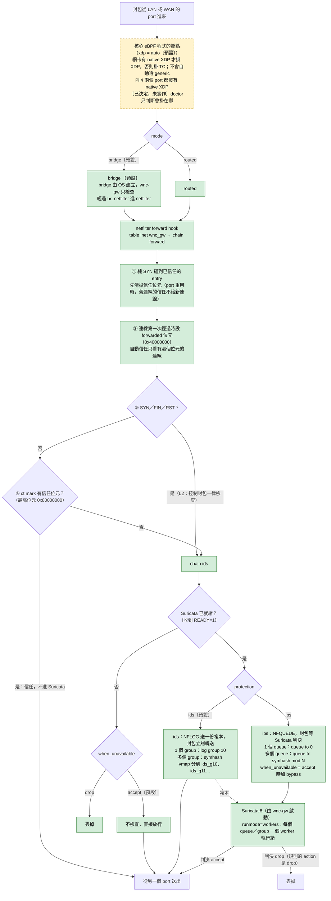
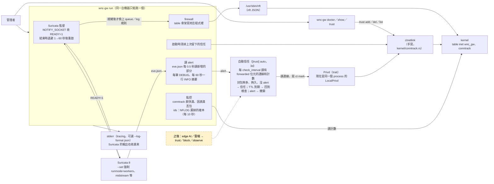

# wnc-gw（security_gateway）

Security gateway 的主程式，Rust 實作，執行檔是 `wnc-gw`。架在內網（LAN）和外網（WAN）之間，轉送的流量先在本機用 Suricata 檢查，之後再把本機判斷不了的交給 edge AI 和雲端。

目前做到階段 1：nftables 把轉送的流量交給 Suricata，用 conntrack 的 ct mark 記錄「已信任」的連線，被信任的連線不進 Suricata。信任可以由管理者手動設，也可以讓 wnc-gw 觀察一段時間、沒有 alert 就自動信任（`[trust] auto`）。

## 用法

```sh
cargo build --release
CARGO_TARGET_AARCH64_UNKNOWN_LINUX_MUSL_LINKER=rust-lld \
  cargo build --release --target aarch64-unknown-linux-musl
```

| 子命令 | 做什麼 |
|---|---|
| `wnc-gw doctor` | 檢查設定、port、kernel 模組、nft、Suricata 和權限，不改任何東西 |
| `wnc-gw run` | 先跑 doctor，再裝 nft table、啟動並監督 Suricata，直到收到 SIGINT／SIGTERM／SIGHUP；結束時移除 table |
| `wnc-gw trust add／del／list` | 手動信任或取消信任一條連線（ct mark） |
| `wnc-gw show interfaces` | 列出網卡，方便在設定檔裡指定 port |
| `wnc-gw explain [代碼]`、`explain --all` | doctor 的每個 error／warning／note 都有代碼（例如 `warning[R006]`），`run` 的每個 WARN／ERROR log 也有（`code=S015`，json 是 `"code":"S015"`）；不帶參數列出全部代碼，帶代碼印出說明（cause：什麼情況會出現；action：怎麼處理），`--all` 印出全部的詳細說明 |

全域選項：`--log-format text|json`、`--log-level error|warn|info|debug|trace`（預設 info；每一筆 alert 的細節要 `debug` 才印）。

設定檔預設在 `/etc/wnc-gw/setting.toml`，每個欄位的說明見 `setting.example.toml`。只在某些選項下才有作用的欄位，在其他情況下設了會直接報錯（C004）：`[suricata] queue` 只能配 `protection = "ips"`、`group` 只能配 `"ids"`，`[trust]` 的其他欄位只能配 `auto = true`。

## 架構圖

圖和表裡的標記：

| 標記 | 意思 |
|---|---|
| 〔已實作〕（綠色） | 已決定，程式裡已經有了 |
| 〔已決定，未實作〕（黃色虛線框） | 已決定，還沒寫程式 |
| 〔待決〕（灰色虛線框） | 還沒決定；有的是建議或實驗結果 |
| 〔預設〕 | 有多種選擇時，沒設定就用這個 |

決策的完整紀錄和量測在 `.claude/skills/gateway-architecture/references/decisions.md`（表裡的 O4、O14 等編號就是那份文件的章節）。

### 1. 封包怎麼走



裝到 kernel 裡的 table（`sudo nft list table inet wnc_gw` 的格式，counter 的數字省略）：

```
table inet wnc_gw {
	chain forward {
		type filter hook forward priority filter; policy accept;
		counter
		tcp flags & (syn | ack) == syn ct mark & 0x80000000 == 0x80000000 counter ct mark set ct mark & 0x7fffffff   # ①
		ct mark & 0x40000000 == 0x00000000 ct mark set ct mark | 0x40000000                                           # ②
		tcp flags fin,syn,rst jump ids                                                                                # ③
		ct mark & 0x80000000 == 0x80000000 counter accept                                                             # ④
		jump ids
	}
	chain ids {
		# Suricata 沒就緒：      counter accept           （when_unavailable = "accept"）
		#                        counter drop             （when_unavailable = "drop"）
		# 就緒、ids、1 個 group： counter log group 10 accept
		# 就緒、ids、多個 group： counter symhash mod 2 vmap { 0 : jump ids_g10, 1 : jump ids_g11 }
		# 就緒、ips、1 個 queue： counter queue flags bypass to 0
		# 就緒、ips、多個 queue： counter queue flags bypass to symhash mod 3
	}
	chain ids_g10 { counter log group 10 accept }   # 只有多個 group 時才有，每個 group 一條 chain
	chain ids_g11 { counter log group 11 accept }
}
```

Suricata 就緒或停止時，wnc-gw 只換掉 `ids` chain 的規則，不重裝整張 table。

### 2. 各個設定分支的差別

圖裡會分岔的設定都在 `setting.toml`。每個分支的實驗、數字和限制見 `DECISIONS.md`（括號裡是章節）。下面的「Pi」數字都是 Pi 4 鎖 1000 MHz 量的。

**`mode`：bridge〔預設〕／routed**（DECISIONS.md §1）

| | bridge〔預設〕 | routed |
|---|---|---|
| 部署 | 插在中間即可，LAN 和 WAN 同一個網段 | LAN 和 WAN 不同網段；不做 NAT，所以上游路由器要加到內網的路由 |
| 怎麼進 nftables | 經過 `br_netfilter`（沒載入時規則完全被繞過） | 一般的 IP 轉送 |
| doctor 檢查 | LAN、WAN 在同一個 bridge；`br_netfilter`、`bridge-nf-call-iptables`／`ip6tables` | LAN、WAN 不在 bridge 裡；`ip_forward`；兩個 port 都有 IPv4 位址（沒有是 warning）、網段不和彼此或其他介面重疊（error）、預設路由走 WAN（warning）；note 寫出內網 gateway 和上游要加的路由 |
| 封包從哪個 port 進來 | `iifname` 都是 `br0`，要靠 ingress 打的 mark〔已決定，未實作〕 | 同樣用 ingress 的 mark，兩種模式共用規則 |
| fast path（tc eBPF） | `bpf_redirect` | `bpf_fib_lookup`（GPL-only helper）＋`bpf_redirect_neigh` |
| 轉送成本（Pi、veth） | 10.7 µs／封包 | 7.9 µs／封包 |
| 轉送成本（Pi、實體網卡，2026-11-04） | 只轉送 @100k：9.97 µs，A0 容量 100 kpps | 8.02 µs，A0 容量 150 kpps；有檢查時只少 2–9%、容量一樣 |
| 非 IP 的封包（ARP 等） | 照常轉送 | 不轉送 |

nft table 兩種模式完全相同，差別只在 `forwarding/` 的環境檢查。

**`protection`：ids〔預設〕／ips**（DECISIONS.md §2）

| | ids〔預設〕 | ips |
|---|---|---|
| 封包要不要等 Suricata | 不用：kernel 立刻轉送，另外用 NFLOG 送一份複本 | 要：封包在 NFQUEUE 等 Suricata 判決 |
| 能不能擋流量 | 不能，只產生 alert | 能，規則的 action 是 drop 就擋 |
| checksum 檢查 | 一定要關（GRO 合併過的複本 checksum 不完整），有 insertion 的風險 | 照常，kernel 會標出 checksum 還沒算的封包 |
| Suricata 跟不上時 | 封包照樣轉送，複本被丟掉；wnc-gw 每 10 秒記一次漏掉幾份 | 看 `when_unavailable` |
| 需要的 kernel 模組 | `nft_log`、`nfnetlink_log` | `nft_queue`、`nfnetlink_queue` |
| Suricata 要支援 | NFLOG | NFQueue |
| Suricata 每個封包的成本（Pi、veth） | 19–24 µs | 35–48 µs |
| 容量（Pi、實體網卡、full 規則） | 一定要開 RPS：不開時轉送只有 30–40 kpps；RPS 到 CPU1–3、3 個 group 時轉送 120、檢查 80 kpps | 1 個 queue 20–30 kpps；最好約 60 kpps（網卡中斷搬到 CPU1＋3 個 queue） |

兩種模式的信任、SYN／FIN／RST 規則都一樣，也都等 Suricata 送出 READY=1 才開始送封包。

**`when_unavailable`：accept〔預設〕／drop**（DECISIONS.md §11）

| 情況 | accept〔預設〕 | drop |
|---|---|---|
| Suricata 啟動中、還沒就緒 | 不檢查，直接放行 | 丟掉 |
| Suricata 結束、重啟中 | 不檢查，直接放行（Suricata 結束那一刻還在 queue 裡的封包會被 kernel 丟掉） | 丟掉 |
| ips：Suricata 跟不上（queue 滿） | 放行（queue 加 `bypass`、`nfq.fail-open=yes`） | 丟掉 |
| ips：Suricata 檢查不了某條 flow（記憶體用完、解析錯誤） | exception policy ignore，照常放行 | drop-flow／drop-packet |
| ids：Suricata 跟不上 | 照樣轉送，只是複本被丟掉 | 一樣照樣轉送（ids 的轉送不經過 Suricata） |
| wnc-gw 停止、table 已移除 | 直接通過 | 直接通過 |

不管哪一種，都會記 log：何時開始沒檢查、沒檢查了多久（`uninspected_ms`）。

**`queue`／`group`：一個〔預設〕或多個**（DECISIONS.md §3、§4）

| | 一個〔預設：queue 0、group 10〕 | 多個（例如 `"0-2"`、`"10-12"`） |
|---|---|---|
| nft 規則 | `queue to 0`／`log group 10` | `queue to symhash mod N`／`symhash mod N vmap` 分到每個 group 一條 chain |
| Suricata 執行緒 | 1 個 worker，只用一顆核心 | 每個 queue／group 一個 worker |
| 怎麼分 | — | symhash：含 port、兩個方向算出同一個值，同一條連線一定在同一個 worker |
| 一條連線佔大部分流量時 | 上限是一個 worker（約 30 kpps） | 一樣只有一個 worker 在忙，要靠信任 |
| 每個封包的成本 | 最低 | 越多越貴（Pi，ids、RPS、50 kpps：worker 從 1 個 group 的 15.6 µs 到 4 個的 29.2 µs） |

預設開幾個還沒決定（DECISIONS.md §20）。

**`xdp`：auto〔預設〕／off／generic**（DECISIONS.md §17）

| | auto〔預設〕 | off | generic |
|---|---|---|---|
| 核心 eBPF 程式掛在哪 | 網卡有 native XDP 就掛 XDP，否則掛 TC | 一律 TC | 即使網卡不支援也掛 generic XDP |
| Pi 4 上 | 兩個 port 都是 TC | TC | generic XDP |
| 代價 | — | 放棄 native XDP 的速度 | 比 TC 慢（省不到建 skb、可能要複製封包），而且整張網卡跳過 GRO；只給測試用 |

核心 eBPF 程式還沒實作，目前只有 doctor 會判斷每個 port 會掛在哪。

**讀 alert：每 `eve_interval` 秒讀一次**（DECISIONS.md §19；不是分支，只有間隔可以設）

wnc-gw 從 suricata.yaml 設定的 eve-log 檔讀 alert，每 `eve_interval` 秒（預設 0.5，0.05–10，可以有小數）看一次檔案長度，只讀上次之後新增的部分；檔案被換掉或截斷時，先讀完舊檔再從頭讀新檔。Pi 上：沒有 alert 時 0.37 ms／秒，每筆 alert 16 µs，延遲 0 到一個間隔。原本另有 inotify（有寫入才醒），Pi 量測每筆 alert 51 µs、只在 alert 稀疏時延遲較低，2026-11-04 刪掉。

**`[trust] auto`：false〔預設，只能手動信任〕／true**（DECISIONS.md §19）

| | false〔預設〕 | true |
|---|---|---|
| 誰信任連線 | 只有管理者用 `wnc-gw trust add` | wnc-gw 自己判斷，`wnc-gw trust add` 也照樣能用 |
| 什麼時候信任 | — | Suricata 在檢查的期間，這條連線兩個方向都已經有 `min_packets`（預設 10）個封包、觀察滿 `min_age`（預設 5）秒、沒有任何 alert；只限 TCP（已建立）和 UDP |
| 信任多久 | 到連線結束、`trust del` 或 wnc-gw 重啟 | `ttl`（預設 900）秒，之後回到檢查，再觀察一次才會再信任 |
| 有 alert 時 | — | 還在觀察的：之後都不信任；已經信任的：立刻撤銷，記 WARN |
| 需要 | — | `net.netfilter.nf_conntrack_acct = 1`、Suricata 把 alert 寫進 eve 檔；doctor 確定沒有就報 error（T002），讀不到 Suricata 設定而無法確認時是 warning，run 照常啟動但關掉自動信任、全部送檢查（T012）；執行中 EVE 讀不到或落後時暫停新增信任（T013） |
| 風險 | — | 信任之後才送的攻擊，到 TTL 結束前都看不到；doctor 一律給 warning |
| log | `trust add／del` 各一行 | 每次信任一行 INFO、撤銷一行 WARN、到期是 DEBUG；有變動時每 60 秒一行摘要 |
| 成本（Pi） | — | 每次讀 conntrack 固定約 7 ms＋每條經過 gateway 的連線 9.4 µs，讀的期間事件迴圈停住；4,000 封包／秒的 8 條長連線時，Suricata 加 wnc-gw 每秒省 85 ms（每個封包 21 µs） |

- `ttl` 的預設 900 秒比 Suricata 的 `flow-timeouts.tcp.established`（600 秒）長：信任結束時 Suricata 已經忘了這條連線，會當成從中間開始的連線接手，不會因為序號過時把封包丟掉（O21）。ips 模式下 `ttl` 不夠長時 doctor 會警告。
- ids 模式下，低流量連線的 payload alert 可能比 `min_age` 晚到（Docker 實測：帶攻擊標記的連線先被信任，連線結束時才因 alert 撤銷；ips 模式下同樣的連線一開始就不被信任）。DECISIONS.md §19 有細節，怎麼處理還沒決定。

### 3. 誰控制什麼



### 4. 決策一覽

每一項的實驗、數字和限制見 `DECISIONS.md`。

**封包路徑**

| 項目 | 用什麼 | 其他選項 | 狀態 | 為什麼（出處） |
|---|---|---|---|---|
| 轉送模式 `mode` | bridge〔預設〕，bridge 由 OS 建立，經過 `br_netfilter` | routed | 〔已實作〕 | 透明部署；Pi 的 kernel 沒有 `nf_conntrack_bridge`（D3，2026-10-24） |
| 檢查模式 `protection` | ids〔預設〕用 **NFLOG** 送複本 | ips 用 **NFQUEUE**，封包等判決 | 〔已實作〕 | NFLOG 不讓轉送等 Suricata，Pi 上整台每個封包省 4–25 µs；ids 要關 checksum 檢查（GRO），doctor 會警告（O18，2026-10-29） |
| 多核分流 | kernel 的 **symhash**（ips：`queue to symhash mod N`；ids：`symhash vmap`） | `queue num 0-N`（只看位址）、Suricata 的 autofp | 〔已實作〕 | 位址 hash 讓同一對 IP 的連線擠在同一個 queue（42-1：12.9 對 26.4 kpps）；symhash 含 port、雙向一致，每個封包只多 0.7–1.8 µs（O14，2026-10-27） |
| Suricata runmode | 強制 **workers**（`--set runmode=workers`） | autofp | 〔已實作〕 | autofp 要在執行緒之間交接，Pi 上整台每個封包多 15–35 µs（O18，2026-10-30） |
| 信任 | **ct mark** 的最高位元，以 conntrack 的一條連線為單位 | nft set 存五元組 | 〔已實作〕（`wnc-gw trust` 手動，或 `[trust] auto`） | 五元組會被 port 重用或偽造封包繞過；Pi 上信任每個封包省 38–68 µs（O17，2026-10-28） |
| 控制封包（L2） | SYN／FIN／RST 一律送 Suricata，規則在信任之前 | 不送 | 〔已實作〕 | 長連線只多約 1 µs（O17，2026-10-28） |
| 寫入 ct mark | **手寫 ctnetlink**（`kernel/conntrack.rs`） | `netlink-packet-netfilter` crate、spawn `conntrack` | 〔已實作〕 | Pi 上每筆：手寫 13 µs、crate 20–51 µs；`conntrack -U` 每筆讀整張表（O17，2026-10-28） |
| 操作 nftables | **nft JSON**，spawn `/usr/sbin/nft` | libnftnl、rustables | 〔已實作〕 | 不連結 GPL 的函式庫；每次約 7.7 ms，所以要批次（O4，2026-10-25） |
| 我們的 table | 骨架寫死在程式，使用者只能管 set 的內容 | 使用者寫 nft 規則 | 〔已實作〕（set 還沒有） | 流程由程式決定，避免設定錯讓程式出錯（O11，2026-10-25） |
| 自動信任（3d） | 讀 conntrack 計數（有 forwarded 位元 `0x40000000` 的連線）和 Suricata 的 alert，判斷後經 `Privd` 寫 ct mark；預設關 | EVE 的 flow 事件、雲端判定 | 〔已實作〕（門檻和 TTL 的預設值是建議值，待確認） | EVE flow 要等連線結束才有；forwarded 位元讓 gateway 自己的連線不被算進來（O22，2026-11-04） |
| 方向判斷 | netdev ingress 打 mark，不用 `iifname` | `iifname` | 〔已決定，未實作〕 | bridge 模式下 forward chain 看到的 `iifname` 是 `br0`，分不出從哪個 port 進來；ingress 打的 mark 帶得到 forward chain（D3，2026-10-24） |
| 核心 eBPF 掛點 `xdp` | auto〔預設〕：native XDP 才掛 XDP，否則 TC | off、generic | 〔已決定，未實作〕（doctor 已會判斷） | generic XDP 比 TC 慢，不自動選（2026-10-24） |
| Fast path | tc eBPF 轉送已信任的 flow | XDP、flowtable | 〔已決定，未實作〕 | 2026-10-20；flowtable 當後端（O5）待決 |

**Suricata 怎麼管**

| 項目 | 用什麼 | 其他選項 | 狀態 | 為什麼（出處） |
|---|---|---|---|---|
| 誰啟動 Suricata | **wnc-gw 自己 spawn** | systemd 管理（之後也要支援） | 〔已實作〕 | 兩種實作同一個生命週期介面（O14，2026-10-26） |
| 什麼時候開始送封包 | 收到 **READY=1** 才換上 queue／log 規則 | 先裝規則 | 〔已實作〕 | Suricata 7.0.10、8.0.7 在初始化時收到封包會 segfault |
| Suricata 沒在檢查時 `when_unavailable` | accept〔預設〕（ips 時加 bypass、`nfq.fail-open=yes`） | drop | 〔已實作〕 | 預設不斷網，但一定記 log：何時沒檢查、沒檢查多久（O14，2026-10-26） |
| exception policy | ips 跟著 `when_unavailable`（accept → ignore，drop → drop-flow／drop-packet）；ids 一律 ignore（拿到的是複本，丟了也擋不到） | 照 suricata.yaml | 〔已實作〕 | Debian 預設的 `auto` 在 IPS 模式等於 drop-flow（O16，2026-10-28） |
| 從中間開始的連線 | `stream.midstream=true`、midstream policy ignore | 丟掉 | 〔已實作〕 | Suricata 重啟、信任後稽核時不能把連線丟掉（O16，2026-10-27） |
| 規則載入失敗 | `engine.init-failure-fatal=no`，失敗的條數記 WARN | 整個 Suricata 不啟動 | 〔已實作〕 | 一條壞規則不該讓整個網路失去檢查（O16，2026-10-28） |
| 停止時 | 換回沒檢查的狀態 → 停 Suricata → 移除 table；SIGHUP 也一樣 | 留著 table | 〔已實作〕 | wnc-gw 沒在跑時流量直接通過（O14，2026-10-28、10-29） |
| Suricata 版本 | 8.0.7；最低 8.0，低於時 doctor 報 error | — | 〔已決定，未實作〕（版本檢查） | 7.0 已 EOL（2026-10-30） |
| alert 怎麼到 wnc-gw | 讀 suricata.yaml 設定的 **eve-log 檔**，只讀新增的部分；每 `eve_interval` 秒（預設 0.5）讀一次 | unix_stream、wnc-gw 強制 Suricata 另外輸出、inotify | 〔已實作〕 | unix_stream 在 live 模式讀取端跟不上時默默丟事件、沒有計數；inotify 在 Pi 上每筆 alert 51 µs（poll 16 µs）（O22，2026-11-04） |
| log | stderr，用 tracing；`--log-format json`、`--log-level`。只放重要資訊和出事時能定位的資訊：alert 細節是 DEBUG、每 60 秒一行摘要，講到連線的都帶五元組和 `flow_id` | 自己寫檔 | 〔已實作〕；Debian 的 systemd `LogNamespace` 〔已決定，未實作〕 | O15，2026-10-26；O22，2026-11-04 |

**還沒決定的**

| 項目 | 現況 |
|---|---|
| 自動信任的預設值 | 〔待決〕目前是建議值：預設關、10 個封包、5 秒、TTL 900 秒、每 5 秒檢查一次（O22） |
| ids 模式下 alert 比 `min_age` 晚到 | 〔待決〕Docker 實測發現；可能的做法：ids 時要求送往 server 的資料超過 Suricata 的重組 chunk、調小 chunk、或加大 `min_age`（DECISIONS.md §19） |
| log 保存多少 | 〔待決〕wnc-gw 自己的 log 要等 systemd unit（journald 的大小上限）；Suricata 的 eve.json、fast.log、stats.log 目前沒有上限（O22） |
| 預設開幾個 queue／group、網卡中斷和 RPS 怎麼放 | 〔待決〕2026-11-03 Pi 實驗：ids 用 RPS（CPU1–3）＋3 個 group，轉送 120、檢查 80 kpps；ips 用 IRQ 搬到 CPU1＋3 個 queue，60 kpps；ips 只開 1 個 queue 只有 20–30 kpps（`tests/cpu_alloc/README.md`） |
| Suricata 要不要輸出 EVE flow 事件 | 〔待決〕3d 的觀察已改用 conntrack 計數（O22），但 Debian 預設的 eve.json 仍輸出 flow；Pi 上離線時每個 flow 事件約 100 µs，live 模式還沒量（`tests/eve_output/README.md`） |
| edge AI 的介面與 CPU 分配 | 〔待決〕O19：跑在同一台機器、無特權、只能回 trust／block／observe 是建議 |
| 已信任 flow 的部分檢查、稽核前要不要讓 Suricata 忘掉 flow | 〔待決〕O20、O21 |
| 拆成 privd／agent 等多個 process | 〔待決〕O1；目前是單一 process，模組照之後的邊界切 |

## 程式結構

| 目錄／檔案 | 內容 |
|---|---|
| `src/cli/` | 子命令（doctor、run、trust、show、explain）和 log 初始化 |
| `src/issue.rs` | doctor 結果和 `run` 的 WARN／ERROR log 的代碼（`Issue`），以及 `explain` 印的說明 |
| `src/config.rs` | 讀設定檔，CLI 參數可以蓋過 |
| `src/ports.rs` | 依名稱或 MAC 找出 LAN、WAN 是哪張網卡 |
| `src/forwarding/` | bridge、routed 兩種模式各自的環境檢查（trait） |
| `src/datapath/` | 核心 eBPF 程式該掛 XDP 還是 TC 的判斷 |
| `src/firewall.rs` | 我們的 nft table、信任與取消信任 |
| `src/agent/` | 3d：自動信任的狀態機（`trust.rs`）和 `Privd` trait（之後拆出有權限的 process 時，換成跨 process 的實作） |
| `src/protection.rs`、`src/ids/` | ids／ips、啟動和監督 Suricata、讀 Suricata 的資訊和 EVE 檔裡的 alert |
| `src/kernel/` | 和 kernel 溝通：nft、ctnetlink、NFLOG／NFQUEUE、模組、sysctl、netlink |
| `src/monitor/` | 執行中的監控（conntrack 表、NFLOG 漏掉的複本、Suricata 的 alert 摘要） |
| `src/platform/` | 依 OS 而不同的部分（目前只有 Debian） |
| `tests/unit/` | 單元測試，路徑對應 `src/` |
